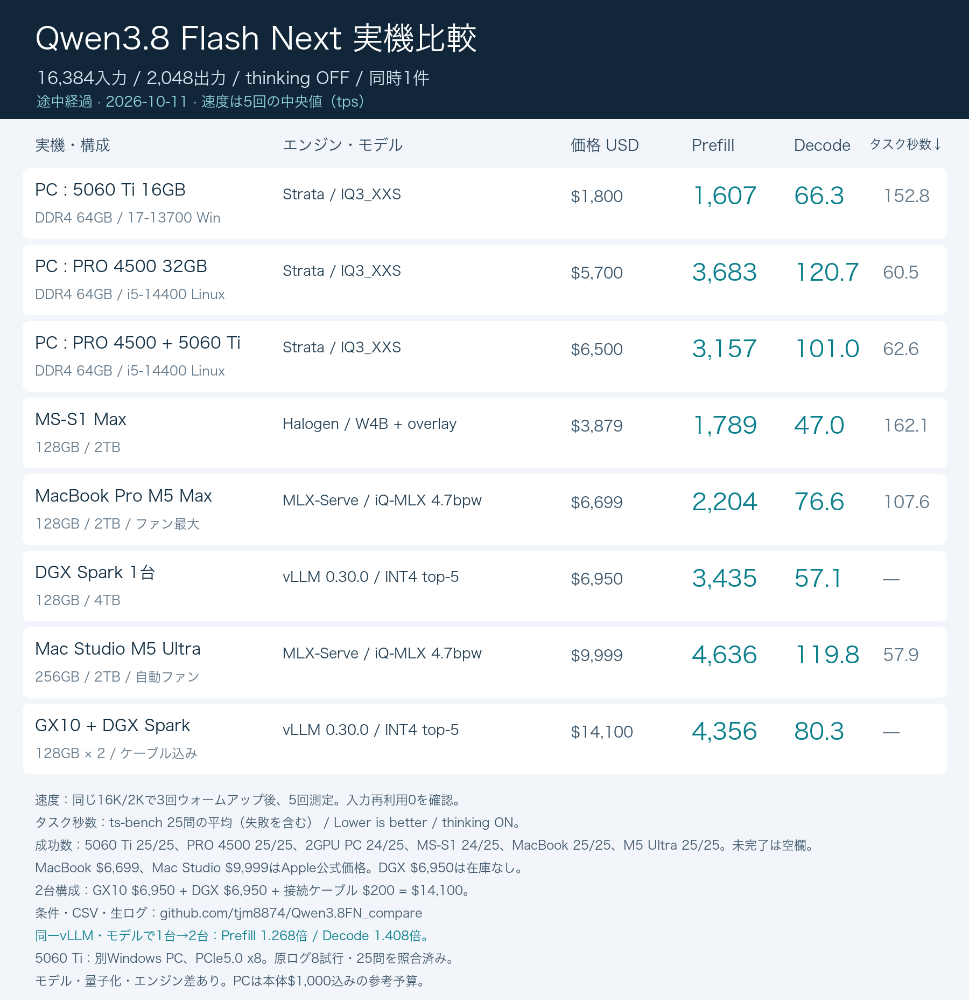

# Qwen3.8-Flash-Next 実機比較

Qwen3.8-Flash-Nextを、現在購入できるPC・Mac・DGX Sparkで動かした際の速度とコーディング能力を測定します。各実機に適したエンジン・モデルを実測して選び、購入後の使い勝手を判断できるデータを残します。比較表は実機ごとに1行とし、試した候補の生ログも保存します。

**2026年10月11日現在、全8構成の速度を掲載しています。画像の右端はts-bench 25問の平均所要時間「タスク秒数」です。Windowsの原ログを受領し、速度8試行と25問を照合しました。Windowsは平均152.77秒、MacBookは107.64秒、Mac Studioは57.94秒で、いずれも25/25問に成功しました。DGX単体は評価中、DGX2台は単体の終了・復旧後に実行します。** 成功数と測定条件は以下に残しています。

## 16K入力では、PRO 4500単独がGPU分割より速かった

今回のStrata・IQ3_XXS・自動配置では、PRO 4500単独のDecode中央値は120.7 tps、PRO 4500＋5060 Tiは101.0 tpsでした。GPUを追加すれば単一リクエストが速くなるとは限らず、この条件で速度を重視するならPRO 4500単独が有力です。配置や条件を変えた場合、別の結論になる可能性があります。

Mac Studio M5 UltraはMLX-Serve 26.10.1・iQ-MLX 4.7bpwでPrefill中央値4,635.5 tps、Decode中央値119.8 tpsでした。モデル・量子化・エンジンが異なるため、PCと同じ条件のハードウェア比較ではありません。このMac Studio構成のDSH評価は25/25問に成功し、タスク秒数は平均57.94秒でした。価格や速度だけで全構成の購入順位を決めず、25問の評価結果と合わせて検討します。

<!-- RESULTS_START -->
| 構成 | Prefill tps | Decode tps | タスク秒数 ↓ | 成功数（補足） | 参考価格 USD |
|---|---:|---:|---:|---:|---:|
| PC : 5060 Ti 16GB | 1,607.1 | 66.3 | 152.8 | 25/25 | $1,800 |
| PC : PRO 4500 32GB | 3,683.0 | 120.7 | 60.5 | 25/25 | $5,700 |
| PC : PRO 4500 + 5060 Ti | 3,157.1 | 101.0 | 62.6 | 24/25 | $6,500 |
| MS-S1 Max | 1,789.0 | 47.0 | 162.1 | 24/25 | $3,879 |
| MacBook Pro M5 Max | 2,204.4 | 76.6 | 107.6 | 25/25 | $6,699 |
| DGX Spark 1台 | 3,434.9 | 57.1 | 未測定 | 未確定 | $6,950 |
| Mac Studio M5 Ultra | 4,635.5 | 119.8 | 57.9 | 25/25 | $9,999 |
| GX10 + DGX Spark | 4,355.8 | 80.3 | 未測定 | 未確定 | $14,100 |
<!-- RESULTS_END -->

速度は5回の中央値です。最小値・最大値、TTFT、全試行の数値は[CSV](data/summary.csv)に収録しています。価格はApple公式価格、所有者の参考予算、販売店の表示価格を区別し、DGX Sparkの公式表示価格は在庫なしの参考値です。[価格の出典・構成・確認日](data/prices.json)をご確認ください。

## 比較する8構成

| 構成 | エンジン・モデル | 参考価格 USD | 状態 |
|---|---|---:|---|
| PC：5060 Ti 16GB・i7-13700・DDR4 64GB | Strata 0.1.42／IQ3_XXS・Windows・PCIe5.0 x8 | $1,800* | 速度・TS-bench25問の原ログ照合済み（25/25） |
| PC：PRO 4500のみ | Strata 0.1.42／IQ3_XXS | $5,700* | 速度測定・DSH25完了 |
| PC：PRO 4500＋5060 Ti | Strata 0.1.42／IQ3_XXS | $6,500* | 速度測定・DSH25完了 |
| MS-S1 Max 128GB・2TB | [Halogen指定レシピ](https://github.com/claudejaune/Qwen3.8-Halogen-Flash-Strix-Halo)／0.17.5・W4B＋品質オーバーレイ | $3,879* | 速度測定・DSH25完了 |
| MacBook Pro M5 Max 128GB・2TB | [MLX-Serve 26.10.1](https://github.com/ddalcu/mlx-serve)／[iQ-MLX 4.7bpw](https://huggingface.co/ddalcu/Qwen3.8-Flash-Next-MLX-Serve-iQ-MLX-4.7bpw)・ファン最大 | $6,699 | 速度・TS-bench25問完了（25/25） |
| DGX Spark 1台 | [vLLM 0.30.0共通ビルド](https://github.com/myllmbox/qwen38-flash-next-cluster-recipe)／INT4 top-5・FP8表 | $6,950† | 単体比較で採用・速度完了・新エンジンのTS-bench実行中 |
| Mac Studio M5 Ultra 256GB・2TB | MLX-Serve 26.10.1／iQ-MLX 4.7bpw・自動ファン | $9,999 | 速度測定・TS-bench25問完了（25/25） |
| GX10＋DGX Spark | 単体と同じvLLM 0.30.0／INT4 top-5・FP8表 | $14,100* | TP2速度完了・単体の評価と復旧後にTS-bench実行 |

\* 所有者が示した参考価格。PC本体はCore i5-14400・DDR4 64GB・Z790Aマザーボードを含めて$1,000、PRO 4500は$4,700、5060 Ti 16GBは$800で計算しています。販売店の確認価格は、確認日・SSDなどの構成・税送料の扱いとともに別途記録します。別Windows PCの実売価格は未提示のため、1行目の$1,800は従来と同じ参考予算です。価格だけで能力を順位づけせず、タスク秒数と成功数も記録します。

MacBook Pro M5 Max 128GB・2TBの$6,699、Mac Studio M5 Ultra 256GB・2TBの$9,999はApple公式価格です。MS-S1 Max 128GB・2TBは$3,879です。GX10＋DGX Sparkは、所有者の指定に合わせて1台あたり$6,950とし、接続ケーブル$200を加えた**$14,100**（$6,950 × 2 ＋ $200）で比較します。GX10単体について、販売店で確認した価格とは区別します。

† [NVIDIA US公式ページ](https://marketplace.nvidia.com/en-us/enterprise/personal-ai-supercomputers/dgx-spark/)の2026年10月10日の表示価格。128GB・4TB構成は在庫なしであり、この価格で今すぐ購入できることを示しません。

Mac Studioは**M5 Ultra・256GB・2TB、$9,999**が正しい構成です。従来の8bitサービスは、申告上の26.10.1に対し、バイナリが26.9.7-devと表示しました。今回の速度更新には検証済みの26.10.1本体を別途使用し、測定後は従来の8bitサービスへ戻しました。

## 16K入力の速度を測る

チャットの形式を含めて16,384入力トークン、2,048出力トークン、thinking OFF、同時実行1件で測定します。モデルを読み込み、同じ16K入力・2K出力で3回ウォームアップした後に5回実行し、入力処理（Prefill）と生成（Decode）の中央値・最小値・最大値を記録します。最初の出力が届くまでの時間（TTFT）は別の項目です。

入力の再利用は回避し、エンジンが報告する再利用数を確認します。入力長が違う実行、途中で回答を終えた実行、再利用が残った実行は、生ログを保存したうえで固定長の比較から除外します。速度を算出するトークン数の定義にエンジン間の差があれば、結果に明記します。

DGX SparkのTensorFoldは、Decodeの分子を「生成トークン数−1」、分母をエンジン内部の入力処理終了から生成終了までの時間としています。APIの総時間・Prefill時間・TTFTは計測区間が異なるため、これらの差からDecodeを再計算しません。[エンジンごとの計算定義](data/native-timing-definitions.json)と生ログを併記しています。

MS-S1 MaxはUbuntuのカーネル7.0.0-38、BIOSのUMA設定Auto、GPU用GTT上限120GiB、accelerator-performanceプロファイルで測定しました。Halogen 0.17.5のW4Bチェックポイントと品質オーバーレイを固定し、入力キャッシュを無効にしています。Prefill中央値は1,789.0 tps、Decode中央値は47.0 tps、TTFT中央値は9.17秒でした。HalogenのDecodeは生成トークン数全体を分子に使い、TensorFold・vLLMの「最初の1トークンを除く」定義との差を[計算定義](data/native-timing-definitions.json)に記録しています。IOMMU設定は変更していません。DSHの25問評価は24/25問に成功し、不成功はreactでした。25問を中断せず実行し、通信エラー・外側のタイムアウトはありませんでした。

MacBook Pro M5 MaxはMLX-Serve 26.10.1（MLX 0.32.3・NAX有効）、iQ-MLX 4.7bpwモデル、ファン最大固定で再測定しました。モデルのリビジョンは`dafff5c3d8168c9d13275661153911096499a80a`、文脈32K、同時1件、入力キャッシュ無効、vision無効です。MTPはエンジン既定の深度6・適応動作、prompt lookupも既定で有効にしました。モデルのn-gram表を含めて読み込み、モデルの転送・検証を終えてから測定しています。

Prefill中央値は**2,204.4 tps**、Decode中央値は**76.6 tps**、TTFT中央値は7.44秒でした。5回の本測定の範囲はPrefill 1,992.8〜2,252.0 tps、Decode 70.1〜77.8 tpsです。両ファンの目標は7,826rpm、測定期間に5秒間隔で記録した実回転数はそれぞれ7,805〜7,847rpm、7,811〜7,843rpmでした。終了後は測定専用エンジンを停止し、Appleの自動ファン制御へ戻しています。最終試行には速度低下が見られましたが、取得した温度センサー値だけから原因を断定しません。[設定・モデルハッシュ](data/raw/speed/macbook-m5max-mlxserve/provenance.json)と[生ログ](data/raw/speed/macbook-m5max-mlxserve/raw.tar.gz)を保存しました。この構成のDSH評価は最大ファンの条件で実行中です。

以前のMTPLX 2.12.2・Optimized Speed 4/8bit・自動ファンでは、Prefill中央値920.8 tps、Decode中央値44.3 tpsでした。[以前の速度ログ](data/raw/speed/macbook-m5max/raw.tar.gz)は履歴として残し、実機ごとに1行の比較表には今回のMLX-Serve構成を採用しています。エンジン・モデル・冷却条件を同時に変更したため、改善をファンだけの効果とは扱いません。MTPLXで途中まで実行したDSHは中止し、正式な25問の成績には含めません。

Mac Studio M5 Ultraでも、同じ固定リビジョンのiQ-MLX 4.7bpwモデルをMLX-Serve 26.10.1で測定しました。文脈32K、同時1件、入力キャッシュ無効、vision無効、MTP深度6・適応動作、prompt lookup有効です。ファンはAppleの自動制御を維持しました。Prefill中央値は**4,635.5 tps**（4,626.2〜4,644.3）、Decode中央値は**119.8 tps**（117.7〜123.8）、TTFT中央値は3.54秒でした。[設定](data/raw/speed/macstudio-m5ultra-mlxserve-iq47/provenance.json)と[生ログ](data/raw/speed/macstudio-m5ultra-mlxserve-iq47/raw.tar.gz)を保存しました。

従来のMLX-Serve 26.9.7-dev・Uncensored 8bitでは、速度中央値3,125.0／100.5 tps、DSH24/25問（不成功：react）でした。[従来の速度ログ](data/raw/speed/macstudio-m5ultra/raw.tar.gz)と[DSH結果](data/raw/evaluation/macstudio-m5ultra/summary.json)は保持しています。新しい4.7bpwモデルは独立した25問評価で25/25問に成功しました。平均所要時間は57.94156秒で、187件の実要求と665回収ファイルを原本のSHA256と照合し、通信障害・外側タイムアウトがないこと、元8bitサービスの復旧も確認しています。旧成功数を新モデルへ引き継いでいません。

MacBookの選択構成によるTS-benchは25/25問に成功し、平均107.64032秒でした。725回収ファイルをM3U原本の全SHA256と独立照合し、207実要求の思考ON・samplingとツール応答、通信エラー0、外側タイムアウト0を確認しました。評価中の最大ファン642標本を検証し、終了後のApple自動制御への復帰と専用エンジン・トンネル・スリープ抑止の終了を確認しています。[評価結果](data/raw/evaluation/macbook-m5max-mlxserve/summary.json)を参照してください。

## 5060 Tiの1行目は別Windows PCの測定へ更新

1行目はCore i7-13700・DDR4 64GB（2666 MT/s）・RTX 5060 Ti 16GB、Windows、負荷中PCIe5.0 x8の構成です。所有者から受領したZIPの全880ファイルのSHA256を照合し、要求・SSE応答・実トークン数・ネイティブ時間・生成出力を全8試行で検証しました。5回の中央値はPrefill **1,607.1 tps**、Decode **66.3 tps**。範囲はそれぞれ1,595.1〜1,621.7、63.2〜67.1 tps、TTFTは10.2631秒、全所要時間は41.2018秒です。[検証済み集計](data/raw/speed/windows-5060ti-verified/summary.json)と[速度生ログ](data/raw/speed/windows-5060ti-verified/raw.tar.gz)を保存しています。所有者側で匿名化された受領ログの検証であり、モデル本体の再ハッシュや実機への接続確認は当方で実施していません。出力テキストのCRLFはLFへ正規化し、SSEから復元した出力と元の出力ハッシュに一致することを確認しました。

受領ログはStrata 0.1.42・同じIQ3_XXSの固定リビジョン、同じ保存済み要求、16K入力・2K出力、再利用0、3回ウォームアップ後5回測定です。旧cudaserverの1,333.1／60.2 tpsと比べ、Prefill約20.6％、Decode約10.1％の改善でした。H2D転送プローブは7.2→24.2 GB/sですが、CPU・RAM・OS・SSD・expert cache・自動配置も異なります。旧PCIe4.0 x4は所有者申告で旧監視ログにはリンク情報がないため、速度差をPCIeだけの効果とは断定しません。

WindowsのTS-benchは25/25問に成功し、各採点JSONの `totalDuration` 合計3,819.157秒から平均 **152.76628秒**と算出しました。[25問集計](data/raw/evaluation/windows-5060ti-verified/summary.json)と[評価生ログ](data/raw/evaluation/windows-5060ti-verified/raw.tar.gz)を保存しています。外側の処理を含むrunner合計3,923.534秒（平均156.941秒）とは区別します。DSHはWSL2 Ubuntu、StrataはWindowsで動作し、エージェント文脈32Kに対してエンジン側文脈は131K、prompt-cacheは0です。固定コミット・同25問・207実要求のsamplingと思考ON、通信エラー0、外側タイムアウト0を確認しました。[旧cudaserverの速度](data/raw/speed/cuda-5060ti/raw.tar.gz)、[旧ts-bench結果](data/raw/evaluation/cuda-5060ti/summary.json)、[以前の提供集計](data/raw/speed/windows-5060ti/reported-summary.json)は履歴として保持します。

## Spark単体ではvLLMがPrefill・Decodeとも速かった

同じ固定INT4 top-5モデル、同じ8個の入力、文脈32K、bf16 KV、入力16,384・出力2,048、再利用0で測定しました。単体・2台に対応する共通ビルドを使い、各3回のウォームアップ後に5回測定しています。

| エンジン | Prefill中央値 tps | Decode中央値 tps | 全所要時間中央値 秒 |
|---|---:|---:|---:|
| TensorFold共通ビルド | 2,593.92 | 47.70 | 49.25 |
| vLLM 0.30.0共通ビルド | 3,434.89 | 57.06 | 40.68 |

vLLMはPrefillが約32.4％、Decodeが約19.6％速く、全所要時間も約17.4％短かったため、Sparkの比較表にはvLLMを採用しました。[比較データ](data/spark-engine-comparison.json)、[TensorFold生ログ](data/raw/speed/spark-single-tensorfold-common/raw.tar.gz)、[vLLM生ログ](data/raw/speed/spark-single-vllm-common-retry/raw.tar.gz)を保存しています。

モデルの固定リビジョンは`1464274120d36a4d8fcaa934552334a7d83ce0fd`です。PLE表の精度は両エンジンとも元のFP8を維持していますが、TensorFoldはGPU常駐、vLLMはNVMeから読み取ります。MTPもTensorFoldは最大15、vLLMは動的3〜7で、vLLMのドラフトだけが10専門家、対象モデルは5専門家です。エンジン間の比較は各実装を含むレシピの比較であり、実装差を取り除いた比較ではありません。

GX10＋Sparkでは、採用したvLLMの同じ固定イメージ・モデル・FP8表形式・NVMe reader・表の各rankへの複製・bf16 KV・MTP・32K文脈を維持し、TP1からTP2へ変更して測定しました。2台レシピ既定のNVFP4変換は使っていません。通信は両RoCEリンクを使用し、両ノードのNET/IBログ、ネイティブRoCE all-reduceの稼働ログ、両リンクの送受信カウンター増加を照合しました。カーネルや機種は実機どおり異なるため、倍率はこのSpark単体からGX10＋Sparkへの構成変更で得られた値として示します。

| 同一vLLM・モデルによる構成 | Prefill tps | Decode tps | 全所要時間 秒 |
|---|---:|---:|---:|
| DGX Spark 1台（TP1） | 3,434.89 | 57.06 | 40.68 |
| GX10＋DGX Spark（TP2） | 4,355.84 | 80.33 | 29.27 |

測定終了後は、元のDeepSeek head・workerを同じコンテナ・設定で再起動し、モデルAPIの復旧を独立確認しました。測定専用コンテナは停止しています。

2台化でPrefillは**1.268倍（約26.8％増）**、Decodeは**1.408倍（約40.8％増）**となり、全所要時間は**約28.0％短縮**しました。各5回の中央値の比で、同じ8個の入力・再利用0・出力2,048を確認しています。速度測定は完了し、新構成でのDSH評価は単体評価と元サービスの復旧後に実施します。[2台構成の生ログ](data/raw/speed/gx10-spark-vllm-common/raw.tar.gz)も保存しています。

vLLMのAPIは再利用数の項目を返さなかったため、入力KVを16,384トークンすべて計算したこと、内部・外部キャッシュの利用がともに0であることをエンジンの実測カウンターで確認しました。最初の検証停止実行は診断用に残し、今回の5回には含めていません。新しく採用したvLLMは新規に25問を評価しており、以前のTensorFoldによる途中16問を引き継ぎません。旧131K条件のTensorFold速度2,620.8／53.4 tpsは[履歴](data/raw/speed/spark-single/raw.tar.gz)として保持しています。

DGX単体の初回評価は、ツール履歴を含む要求が32K文脈を1トークン超えたため、途中実行全体を正式成績から除外し原ログを診断用に保存しました。再実行では、ツール定義と思考用テンプレートを含むエンジンの実測入力数から応答枠を計算し、32トークンの余地を確保します。履歴やモデルは切り詰めず、単体・2台の両方に同じ処理を適用します。トークン計数の待ち時間もタスク時間に含みます。評価開始前に短い実応答で上限に収まることを確認し、この事前試験を正式25問の平均には含めません。

## タスク秒数は25問すべての平均所要時間

画像の「タスク秒数 ↓」は、ts-benchが各課題の結果へ記録する `totalDuration`（ミリ秒）を25問分合計し、25で割って秒に換算した値です。**Lower is better（小さいほど速い）**で、思考・回答生成・ツール実行・テスト・修正の繰り返しを含む実際の課題処理時間を示します。外側の起動処理を含む `runner_wall_seconds` と、固定2K出力の速度測定とは別の指標です。

成功した課題だけを選ぶと構成ごとに対象が変わるため、モデルが失敗した課題も含めた同じ25問を平均します。通信障害を含む実行や25問未完了の実行は掲載しません。失敗して早く終了した実行は良い時間に見えることがあるので、成功数はREADME・CSVに残し、平均時間だけで優劣を決めません。同じ基本モデルでも量子化・専門家削減・エンジン・生成内容が異なり、成功数が同じになるとは限りません。

既存の25問結果から計算した平均は、2GPU PC **62.6秒（24/25成功）**、PRO 4500単体 **60.5秒（25/25成功）**、MS-S1 Max **162.1秒（24/25成功）**、今回のMac Studio M5 Ultra **57.9秒（25/25成功）**、MacBook Pro M5 Max **107.6秒（25/25成功）**、別Windows PC **152.8秒（25/25成功）**です。未測定の新構成は空欄にし、旧モデル・旧PCの値を引き継ぎません。

DSH 0.1.5-rc.3、同一のts-bench・Exercismコミット、[同じ25問](data/exercises.txt)を使用します。thinking ON、エージェントの文脈上限32K、1応答の出力上限16K、1問20分、逐次実行で条件をそろえます。temperature 1、top_p 0.95、top_k 20、seed 16を中継処理で指定し、実際に送った要求を保存します。成功数、所要時間、タイムアウト、ツールの失敗を分けて記録します。

ts-benchにはDSH用のアダプターを追加しています。固定コミットからの変更は[パッチ](data/harness.patch)、実行方法は[scripts/](scripts/)に収録しています。未変更のts-benchによる標準結果ではありません。

## モデル差を含めて、購入時の選択肢を比べる

PCの3行は同一IQ3_XXSモデルを使います。2・3行目は同じi5-14400 PCのGPU構成比較ですが、1行目はi7-13700の別Windows PCで、CPU・OS・PCIe等も異なります。全8行では量子化、Uncensored版、モデルの削減、実行エンジンが異なります。DGX Spark 1台の削減モデルも採用し、「1台買った場合、このレシピは役立つか」を速度と評価結果から検討します。DGXについては、まずSpark単体で同じ固定INT4 top-5チェックポイントを使い、TensorFoldとvLLMのPrefill・Decodeを比較します。採用したエンジンの同じビルド・モデル・実行時量子化・KV精度・MTP設定でGX10＋Sparkの2台構成を測定し、台数を増やした場合の速度倍率を算出します。エンジン間の実行時形式の違いは記録し、PrefillとDecodeで順位が異なる場合は両方の結果を示して採用を決めます。単体ではPrefill・Decodeとも速かったvLLMを採用し、2台化による速度倍率はPrefill約1.27倍、Decode約1.41倍でした。この比較から、ハードウェアだけの優劣を断定することはできません。

## データをたどれる形で公開する

公開用ログとスクリプトでは、LANアドレス、ネットワークGID、個人フォルダを`<PRIVATE_IP>`・`<PRIVATE_GID>`・`<HOME>`・`<WINDOWS_HOME>`に置換しています。スクリプトを再実行する際は、自分の環境の値に設定してください。

- `data/protocol.json`：測定条件
- `data/targets.json`：実機・レシピ・価格の前提
- `data/summary.csv`：集計結果。未測定の値は空欄
- `data/prices.json`：参考価格の出典、構成、在庫・予約状況
- `data/raw/`：個別の計測値と、生ログをまとめた`raw.tar.gz`。要求、出力、SSE、設定、取得できたテレメトリを収録
- `images/`：Xで読みやすい比較表画像。現時点の画像には「途中経過」と明記

APIキー、実機のプライベートアドレス、シリアル番号、個人のファイルパスは公開データに含めません。生ログの公開版では必要な箇所を伏せ、原本と公開版のハッシュ、伏せ方を`archive-manifest.json`に記録します。短い出力による予備測定と入力長の調整用要求は、速度の集計から除外しています。Xへの最終投稿文は、測定結果がそろった段階で作成します。
